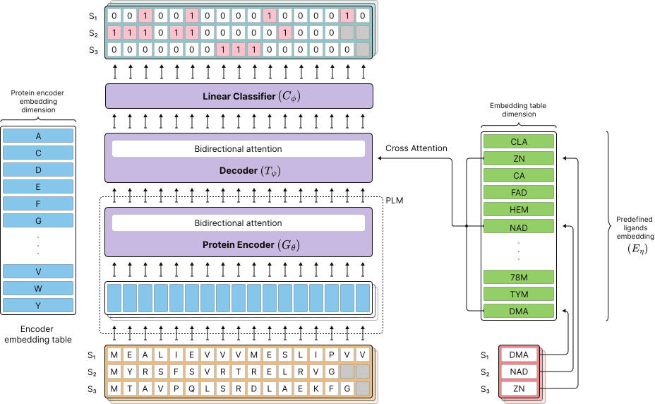
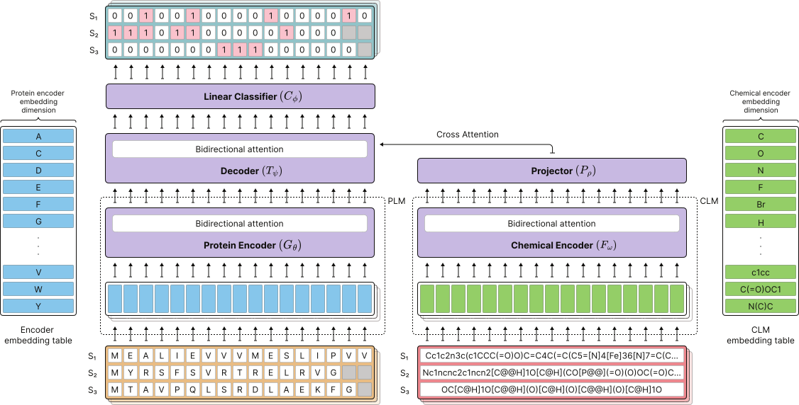

# Zero-Shot Protein-Ligand Binding Site Detection

## Abstract

Accurate identification of protein-ligand binding sites is critical for mechanistic biology and drug discovery, yet predictive performance varies substantially across ligand families and data-availability regimes. We present a systematic ligand-aware benchmark and evaluation framework for residue-level binding-site prediction across three settings: overrepresented ligands with abundant examples, underrepresented ligands with limited examples, and zero-shot ligands unseen during training.

Using a BioLiP2-derived dataset with ligand-specific sequence clustering, we evaluate a progressive three-stage sequence-based modeling suite designed to study these regimes. Stage 1 trains ligand-specific predictors using a pretrained protein language model (PLM). Stage 2 introduces ligand conditioning through learned embeddings, enabling a single multi-ligand model. Stage 3 replaces these embeddings with representations from a pretrained chemical language model (CLM) operating on SMILES, enabling prediction for previously unseen ligands. In the original three-stage comparison, Stage 2 achieved a higher ligand-macro F1 than Stage 1 on the overrepresented test set (0.5832 versus 0.4769), although the comparison simultaneously changes predictor architecture, ligand conditioning, and the training regime. Stage 2 also outperformed several sequence- and structure-based baselines. Stage 3 achieves a pooled residue-level F1 of 0.3109 and a ligand-macro F1 of 0.2338 on previously unseen ligands, while remaining competitive on represented ligands.

Control experiments using constant, mismatched, and scrambled SMILES inputs reduce performance across all three test regimes, providing evidence that the model uses information associated with the supplied ligand input rather than relying solely on generic protein binding-site propensity. Ablations across five PLM scales and multiple CLMs further show that increasing PLM scale generally improves performance, although the trend is not strictly monotonic, whereas CLM scaling produces smaller and less consistent gains. Overall, this study provides a systematic benchmark for quantifying the effect of ligand data availability on residue-level binding-site prediction and for evaluating generalization to previously unseen ligands.

## News
- 🗓️ **12 Nov 2026** — 🎉 Our paper was accepted to *Bioinformatics* and is now [available online](https://doi.org/10.1093/bioinformatics/btag826)!
- 🗓️ **25 Sept 2025** — 🎉 Our paper was accepted to the NeurIPS 2025 AI4Science workshop!
- 🗓️ **30 Sept 2025** — Our preprint was published on bioRxiv. [Read the revised version](https://www.biorxiv.org/content/10.1101/2025.09.28.679103v2).

## Model Architecture

### Stage 2: Multi-Ligand Model with Embedding Table


### Stage 3: Zero-Shot Model with Chemical Language Model


## Installation

Follow these steps on Ubuntu to set up a clean Python environment and run the installer script.

- Prerequisites: Ubuntu 20.04+ with Python 3.9–3.11 and pip. GPU is optional.
- Recommended: use a virtual environment to avoid conflicting packages.

```bash

# 1) Create and activate a virtual environment (in project root)
python3 -m venv .venv
source .venv/bin/activate

# 2) Make the installer executable and run it
chmod +x install.sh
./install.sh
```
<!--
## Downloading Datasets

We provide [datasets](https://mailmissouri-my.sharepoint.com/:f:/r/personal/mpngf_umsystem_edu/Documents/Github/Zero-Shot%20Protein-Ligand%20Binding%20Site/BioLip2?csf=1&web=1&e=sj0hsh) for the three evaluation stages described in the manuscript: overrepresented (ligands with >=100 samples), underrepresented (20-99 samples), and zero-shot (<20 samples). These datasets have been slightly modified for compatibility with the UNIMOL 2 chemical encoder (see manuscript Appendix for details). We also release the original unmodified datasets for future research.

- Original unmodified datasets: [link](https://mailmissouri-my.sharepoint.com/:f:/r/personal/mpngf_umsystem_edu/Documents/Github/Zero-Shot%20Protein-Ligand%20Binding%20Site/BioLip2/Original%20datasets?csf=1&web=1&e=o0GNGA)

- Modified datasets: [link](https://mailmissouri-my.sharepoint.com/:f:/g/personal/mpngf_umsystem_edu/EibmSj_qXixMn1TZB9vOzNMBzZveaY_P2XzGx-jlbgmqiw?e=ABKN12)
-->

## Downloading Datasets

We provide datasets for the three evaluation stages described in the manuscript: overrepresented (ligands with >=100 samples), underrepresented (20–99 samples), and zero-shot (<20 samples). Both the original datasets and the modified datasets used for the revised Stage 3 evaluation are provided for reproducibility.

The datasets are archived on Zenodo:

**Dataset (Version 1.0):** https://zenodo.org/records/23042604

## Inference

Run residue-level binding-site predictions from a trained checkpoint.

### 1. Prepare the inference workspace

1. `cd inference`
2. Download checkpoints into this directory:
   - **Stage 2** (embedding table): [download](https://mailmissouri-my.sharepoint.com/:u:/g/personal/mpngf_umsystem_edu/Ef-_BQfoVchFjLdSPPOs1w4BSzLocvT-sfPXOm06cK-J8g?e=OHbGyL)  
   *Note: This checkpoint only supports 166 ligands, not the full 167 reported in the paper. This is because it was trained on an older version of the dataset.*
   - **Stage 3** (chemical encoder): [download](https://mailmissouri-my.sharepoint.com/:u:/g/personal/mpngf_umsystem_edu/ERN92UnmoYZIgyh0p-7SnZcBLex5-0FSzW6uWd9QS-jaUQ?e=9kIJOi)
3. Place your input CSV under `inference/data/`. An example file is provided at `inference/data/example_data.csv`.

### 2. Configure inputs

Update `inference/configs/config.yaml`:

- `input_csv_path`: path to your CSV (e.g., `./data/example_data.csv`).
- `output_csv_path`: output file for predictions (e.g., `./data/stage2_predictions.csv`).
- `checkpoint_path`: choose either `./stage2_checkpoint.pth` or `./stage3_checkpoint.pth`.
- `stage_3`: set to `false` for Stage 2, `true` for Stage 3.
- `device_type`: `cuda` or `cpu`.

Additional expectations:

- The CSV must contain columns named `ligand_name` and `protein_sequence` (configurable via `lig_name_col` / `prot_seq_col`).
- Stage 2 accepts only the 166 ligands seen during training; ensure ligand names match those in `example_data.csv`.
- Stage 3 requires a `SMILES` column with valid strings for every row (zero-shot ligands are allowed).

### 3. Run inference

From the `inference` directory (with the environment activated):

```bash
python inference.py
```

The script loads the checkpoint, runs predictions with automatic mixed precision by default, and writes a CSV with:

- `predictions`: list of 0/1 residue labels (`prediction_threshold` controls the cutoff).
- `positive_indices`: residue indices predicted as binding.
- `binding_probabilities`: per-residue probabilities (enabled by `output_binding_probs`).

### 4. Working with outputs

- For the supplied `example_data.csv`, Stage 2 and Stage 3 can be run back-to-back by toggling `stage_3` and `checkpoint_path` as described above.
- To use custom data, ensure sequences are plain amino-acid strings and, for Stage 3, SMILES strings are present. Adjust `prediction_threshold` or post-process the probability column to suit your application.

> **Note:** Inference has only been validated with mixed-precision enabled on NVIDIA GPUs. If you need pure CPU or full-precision runs, test carefully before relying on the outputs. The first run downloads the ESM backbone weights (used by both Stage 2 and Stage 3) into `inference/hf_cache/`; Stage 3 additionally fetches the MoLFormer chemical encoder. Subsequent runs reuse those files.


## Results

Benchmarking the three Stages on the test sets. Macro F1 scores are based on the average of F1 for each type of ligand.

| Method | Training Dataset | Overrepresented Macro F1 | Underrepresented Macro F1 | Zero-shot Macro F1 | Zero-shot F1 |
|--------|------------------|--------------------------|---------------------------|-------------------|--------------|
| Stage 1 | Overrepresented (separated) | 0.4769 | - | - | - |
| Stage 2 | Overrepresented | 0.5826 ±0.0035 | - | - | - |
| Stage 2 | Overrepresented + Underrepresented | 0.5832 ±0.0014 | 0.3752 ±0.0049 | - | - |
| Stage 3 | Overrepresented + Underrepresented | 0.5526 ±0.0012 | 0.3603 ±0.0029 | 0.2338 ±0.0051 | 0.3109 ±0.0087 |

Comparison of our method’s best performance for each ligand with other available methods on selected ligands in the overrepresented test set based on F1 score. The main values are taken from the original papers, and ∗ indicates methods evaluated on our test sets.

| Ligand | Stage 2 (Our) | Prot2Token | TargetS | LMetalSite | ZinCap | MIB2 | Boltz-2x |
|--------|---------------|------------|---------|------------|--------|------|----------|
| Ca²⁺ | 0.6958 ±0.0011 | 0.6566∗ | 0.392∗ | 0.526 (0.7370∗) | - | - | 0.380∗ |
| Mg²⁺ | 0.5637 ±0.0036 | 0.4603∗ | 0.433∗ | 0.367 (0.5560∗) | - | - | 0.339∗ |
| Zn²⁺ | 0.8180 ±0.0017 | 0.7594∗ | 0.660∗ | 0.760 (0.8299∗) | 0.451∗ | - | 0.557∗ |
| Mn²⁺ | 0.7663 ±0.0113 | 0.7376∗ | 0.579∗ | 0.662 (0.8048∗) | - | - | 0.419∗ |

## 📜 Citation

If you use this code or the pretrained models, please cite our paper in *Bioinformatics*:

```bibtex
@article{Pourmirzaei2026,
	author = {Pourmirzaei, Mahdi and Alqarghuli, Salhuldin and Chen, Kai and Pourmirzaei, Mohammadreza and Xu, Dong},
	title = {Zero-Shot Protein-Ligand Binding Site Prediction from Protein Sequence and {SMILES}},
	journal = {Bioinformatics},
	year = {2026},
	pages = {btag826},
	doi = {10.1093/bioinformatics/btag826},
	url = {https://doi.org/10.1093/bioinformatics/btag826}
}
```
